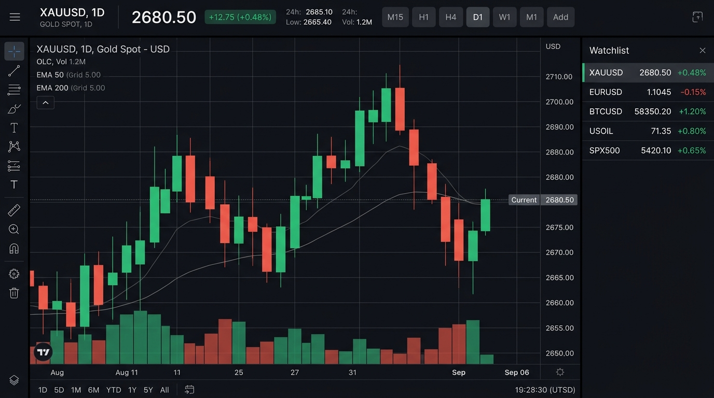
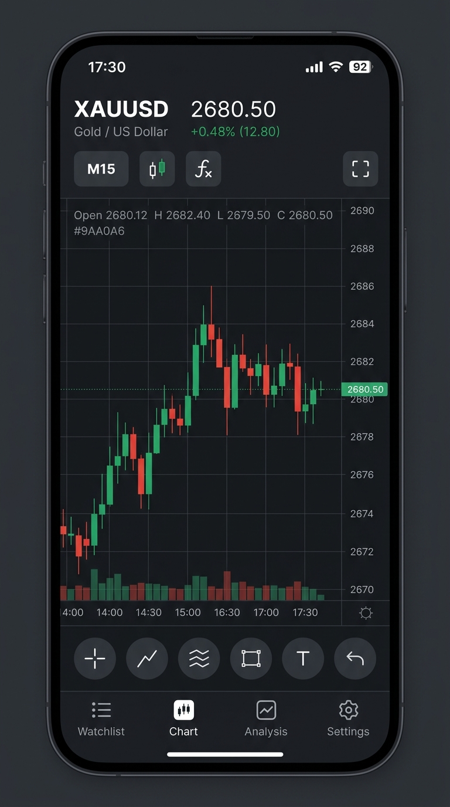

# Implementation Plan: CHART — Complete UI/UX Redesign

A unified, professional redesign of the CHART platform delivering a high-focus trading workspace for **Desktop Web** and an ergonomic, touch-first experience for **Android Mobile**.

---

## 1. Visual Mockups & Design System Direction

As requested, two high-fidelity visual mockups have been generated to preview the design language:

### A. Desktop Trading Terminal
- **Layout:** High-ratio central workspace (>75% screen space), compact top header bar (<48px) with live quote and timeframes, vertical drawing tool rail on the left (TradingView-style), and collapsible watchlist panel on the right.
- **Visual Reference:**
  

### B. Android Mobile Web Experience
- **Layout:** Sticky compact top info bar with ticker and fullscreen toggle, dominant responsive candlestick viewport with zero scroll interference (`touch-action: none`), quick drawing tool chips above the bottom navigation, and a 48dp Material 3 bottom navigation bar.
- **Visual Reference:**
  

---

## 2. Design Tokens & Visual Architecture

A single, shared design system (`theme.css`) with consistent tokens across both Web and Android:

| Token Category | Values & Specifications |
|---|---|
| **Backgrounds** | Deep Charcoal `#0B0F17` (Canvas base), Elevated Graphite `#131A26` (Surfaces), `#182232` (Hover/Active) |
| **Borders** | Subtle border `#1F2937` (1px clean dividers) |
| **Market Colors** | Bullish Emerald `#10B981`, Bearish Coral `#F43F5E`, Warning/Crosshair Gold `#F59E0B` |
| **Typography** | Body/UI: **Vazirmatn** (Persian RTL & English), Numerics/Coordinates: **JetBrains Mono** (LTR tabular numbers) |
| **Component Density** | Desktop: Compact 36-40px headers; Mobile: Touch-optimized 48px minimum touch targets |

---

## 3. Desktop Web Experience (`host_subdomain/`)

### Key Components & Layout:
1. **Compact Top Navigation Header:**
   - Symbol badge and dropdown (XAUUSD, SPOTBRENT, custom symbols).
   - Live price with real-time percentage change badge.
   - Timeframe switchers: `M15`, `H1`, `H4`, `D1` (directly accessible, zero nested menus).
   - Chart type toggle (Candlestick vs. Line).
   - Actions: Fullscreen mode, Sync Now, Workspace Screen Switcher.
2. **Left Vertical Tool Rail (TradingView-style):**
   - Slim vertical dock with icons for Crosshair, Trendline, Horizontal Line, Vertical Line, Delete Selected, and Clear All.
   - Active tool highlight indicator.
3. **Dominant Chart Canvas:**
   - Automatically occupies 100% of remaining viewport width and height.
   - Floating OHLC pill at the top-left showing open, high, low, close of the hovered candle.
   - Price scale on the right, time scale on the bottom.
4. **Collapsible Secondary Panels:**
   - Watchlist and settings slide out as side panels without squeezing the chart into unusable dimensions.

---

## 4. Android Mobile Experience (`host_subdomain/`)

### Key Components & Layout:
1. **Sticky Compact Header:**
   - Ticker code, live price, +% badge, active timeframe chip, and fullscreen button.
2. **Touch-First Fullscreen Chart:**
   - Viewport lock using `touch-action: none` on the chart canvas to eliminate accidental page bounce or scrolling while panning or zooming.
   - Support for pinch-to-zoom and horizontal swipe for historical candle navigation.
3. **Drawing Toolbar:**
   - Horizontal toolbar directly below the chart with icon chips for placing lines and markers.
4. **Fixed Bottom Navigation Bar:**
   - 4-tab navigation: **Watchlist**, **Chart**, **Analysis**, **Settings**.
   - Accessible with one hand, minimum 48dp tap target size.
5. **Landscape Mode:**
   - Automatically maximizes canvas to 100% screen area with ultra-compact floating controls for full-screen analysis.

---

## 5. Android Native Compose Alignment (`app/`)

- Ensure the Android native application (`ChartViewScreen.kt`, `CandlestickCanvas.kt`, `SettingsScreen.kt`, `WatchlistScreen.kt`) maintains 100% parity with the exact same visual tokens, color choices, and navigation paradigm.

---

## 6. Implementation Stages & Proposed Steps

1. **Stage 1 — Core Design System (`theme.css`):**
   - Implement the complete token system (deep charcoal palette, typography, responsive breakpoints, tool rail classes, and touch-action rules).
2. **Stage 2 — Web Application Shell & Layout (`index.html` & `app.js`):**
   - Restructure desktop layout with top ticker bar, left vertical drawing rail, and full-viewport chart area.
   - Implement responsive breakpoints switching to mobile bottom navigation and compact sticky header under 768px.
3. **Stage 3 — Chart Canvas Touch & Desktop Ergonomics:**
   - Add mouse wheel zoom and canvas drag for desktop.
   - Refine touch events (pinch-to-zoom, pan) without page scrolling on mobile.
   - Implement full-screen mode toggle.
4. **Stage 4 — Functional Verification:**
   - Verify all existing features: real data sync (Dukascopy, Twelve Data, Yahoo, EIA), timeframe aggregation (M15 to H1/H4/D1), drawing tools persistence, dynamic color customization, and custom symbol creation.
   - Run compilation and unit tests: `compile_applet` and `gradle :app:testDebugUnitTest`.

---

## User Confirmation & Next Steps
Please review the generated visual mockups and this implementation plan. Click **Proceed** to begin implementation.
