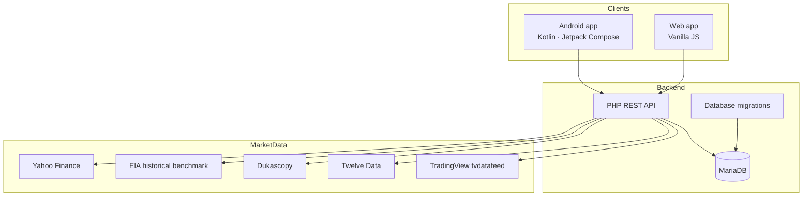

<!--
CHART Intelligence — project landing page
Detailed engineering and operational material: docs/PROJECT_GUIDE.md
-->

<p align="center">
  
</p>

<h1 align="center">CHART Intelligence</h1>

<p align="center">
  <strong>A modular financial chart analysis platform for web and Android.</strong><br>
  Multi-timeframe market data · Technical analysis foundation · Forecast evaluation roadmap
</p>

<p align="center">
  <a href="https://chart.manico.es"></a>
  <a href="https://github.com/manidigit/CHART/actions/workflows/build-apk.yml"></a>
  <a href="https://github.com/manidigit/CHART"></a>
  <a href="https://github.com/manidigit/CHART/blob/main/docs/CHART_INTELLIGENCE_MASTER_SPEC.md"></a>
</p>

<p align="center">
  <a href="#overview">Overview</a> ·
  <a href="#product">Product</a> ·
  <a href="#architecture">Architecture</a> ·
  <a href="#roadmap">Roadmap</a> ·
  <a href="#data-sources">Data sources</a> ·
  <a href="#documentation">Documentation</a>
</p>

---

## Overview

**CHART Intelligence** is being built as an independent platform for viewing and analyzing financial market charts across multiple timeframes. The project combines an Android application with a web application and a modular data-provider architecture.

The engineering direction prioritizes reliable market-series identity, consistent UTC candle boundaries, independently testable algorithms, and a feedback process for evaluating forecast quality.

> **Project status:** Phase 1 implementation is present in the repository. Phases 2–6 are roadmap items and must not be interpreted as shipped capabilities.

## Product

### Current foundation — Phase 1

- **100% Web + Android Cross-Platform Parity (TradingView Pro Standard `v1.29.0`):** responsive web desktop terminal and native Android Jetpack Compose application engineered to the identical TradingView dark palette (`#131722`), visual asset emblems (`XAUUSD` gold bars, `SPOTBRENT` oil droplet, `XAGUSD` silver bars, `EURUSD` FX), and compact ergonomics.
- **Holistic 4-Section Architecture:** coordinated navigation across **Watchlist**, **Chart**, **Prediction** (standalone forecast & scenario workspace), and **Settings** unified in the Right Dock Rail on Desktop Web and the 4-Tab Bar on Android.
- **Smart Multi-Pane Chart Workspace:** top bar with symbol selector + asset icon, candle timeframes (`15m`, `1h`, `4h`, `1D`, `1W`), chart style, and unified **Indicators (`اندیکاتورها`)** modal/sheet (`SMA 20`, `EMA 50`, `Bollinger Bands (20, 2)`, `Volume` with `16% / 22% / 30%` height), Heckbert nice-number Y-axis price scaling, span-aware UTC X-axis time formatting, and bottom historical date range bar (`1D`, `5D`, `1W`, `1M`, `3M`, `6M`, `9M`, `YTD`, `1Y`, `5Y`, `All`) with automatic resolution switching.
- **Bilingual interface:** Persian (RTL) and English (LTR), with Persian as the initial language and strict `LTR` tabular numeric formatting (`JetBrains Mono`) for prices, timestamps, and OHLC axes.
- **Watchlist & 5,000-Candle Capacity:** pre-configured Gold (`XAUUSD`) and Spot Brent (`SPOTBRENT`) instruments with custom circular vector asset icons, search + category filter chips (`ALL | METALS | ENERGY | FX`), draggable split panes, up to **5,000 closed candles** per timeframe (`M15`, `H1`, `H4`, `D1`, `W1`), weekend synthetic flat-candle filtering, and 5-group **Settings** with live 3-candle color preview and algorithm parameter sliders.
- **Unified personal access, session persistence & recovery:** cross-platform owner login synced across Web and Android (`auth.php`) with persistent `Remember Me` session storage, recovery email registration, and 2-step 6-digit email password reset.

### Planned capabilities

| Phase | Focus | Planned outcome |
|---:|---|---|
| 1 | Product foundation | Modular Web/Android app, 4-tab TradingView UI, localization, login, watchlist and multi-pane charts |
| 2 | Technical indicators | M15/M30/H1/H4/D1 and SMA, EMA, Bollinger Bands, RSI, MACD and ATR |
| 3 | Data integrity | Gap detection (`detect_gaps`), historical imports and encrypted backup/restore |
| 4 | Prediction Engine v1 | 3-stage pipeline (Market Structure, Confluence Matrix, Scenario Generator) and immutable forecasts |
| 5 | Live feedback | Forecast scoring, Learning Evaluator, Pattern Track Record, Walk-Forward and model governance |
| 6 | Strategy simulator | Independent strategy simulation and multi-user administration |

The roadmap is governed by a build → install → practical test → owner approval gate. Work on a later phase starts only after the current phase has been tested and approved.

## Architecture

The repository separates the Android client, web client, PHP API, data-provider adapters and database migrations.



This diagram shows the repository's application boundaries and provider direction; it is not a claim that every future workflow or production deployment automation is complete.

### Technology

| Layer | Technology |
|---|---|
| Android | Kotlin, Jetpack Compose |
| Web | Modular Vanilla JavaScript (ES6+) |
| Chart rendering | TradingView Lightweight Charts (Web) · Custom Compose Canvas (Android) |
| Backend API | PHP |
| Database | MariaDB |
| Automation | GitHub Actions |
| Hosting target | cPanel — `chart.manico.es` |

## Data sources

CHART keeps market-series identity explicit. Spot, CFD and Futures prices are distinct instruments and must not be silently merged. Data sources are configured exclusively per symbol inside **Settings** (the Chart header displays the active source badge in read-only mode).

| Market series | Provider symbol | Intended role |
|---|---|---|
| Gold Spot | Twelve Data `XAU/USD` | Primary configured source for `XAUUSD` |
| Gold | Dukascopy `xauusd` | Alternative source |
| Spot Brent CFD | TradingView (`tvdatafeed`) `PEPPERSTONE:SPOTBRENT` | Primary configured source for `SPOTBRENT` (up to 5,000 candles across M15/H1/H4/D1) |
| Brent Oil CFD | Dukascopy `brentcmdusd` | Alternative intraday source |
| Brent | Twelve Data `XBR/USD` | Optional provider route; plan limits must be handled |
| Brent Futures | Yahoo Finance `BZ=F` | Separate futures series |
| Europe Brent Spot Price FOB | EIA `RBRTEd` | Daily historical benchmark |

Historical EIA data: [Europe Brent Spot Price FOB — CSV/XLS source](https://www.eia.gov/dnav/pet/hist_xls/RBRTEd.xls).

Provider availability, plan restrictions, licensing and timeframe coverage must be validated for the selected account and instrument. A provider symbol is not interchangeable with another series merely because both refer to Brent or Gold.

## Repository layout

All markdown documentation (except `README.md`) is consolidated inside the `docs/` directory:

```text
.
├── app/                         # Android application (Kotlin, Compose, Coordinators)
├── host_subdomain/
│   ├── api/v1/                  # PHP REST API (auth.php, candles_sync.php)
│   ├── scripts/                 # Python/PHP tvdatafeed extraction & MariaDB sync scripts
│   ├── assets/                  # Web Native ES6 modules, styles, and renderer
│   ├── i18n/                    # Web translations (fa/en)
│   └── migrations/              # Database migrations
├── docs/
│   ├── assets/chart-hero.svg             # README artwork
│   ├── AGENTS.md                         # Operational rules, design directives & user flow
│   ├── ARCHITECTURE.md                   # System design & layer diagrams
│   ├── CHANGELOG.md                      # Release notes & version history
│   ├── CHART_INTELLIGENCE_MASTER_SPEC.md # Master specification (Source of Truth)
│   ├── CONTRIBUTING.md                   # Contribution guidelines
│   ├── DESIGN_WORKSPACE_SPEC.md          # Chart workspace UI/UX & layout spec
│   ├── INFRASTRUCTURE_INVENTORY.md       # Verified infrastructure & deployment inventory
│   ├── PROJECT_GUIDE.md                  # Project & developer guide
│   ├── SECURITY.md                       # Security policy
│   ├── TRADING_STRATEGY_SPEC.md          # Strategy simulation module specification
│   └── UI_UX_MOBILE_REDESIGN_SPEC.md     # Mobile UI/UX redesign roadmap (TradingView standard)
├── .github/workflows/
│   └── build-apk.yml                     # Android APK build + Web/DB deployment workflow
└── README.md                    # Project landing page
```

## Build and delivery

- **Android APK:** run the [Build APK workflow](https://github.com/manidigit/CHART/actions/workflows/build-apk.yml) manually using GitHub Actions. The workflow produces a downloadable artifact.
- **Web application:** [chart.manico.es](https://chart.manico.es).
- **Deployment automation:** the current repository inventory records the APK build workflow; a cPanel deployment workflow is a separate pending operational task.

## Documentation

All project documentation is consolidated within the `docs/` folder:

| Document | Purpose |
|---|---|
| [Master Specification](docs/CHART_INTELLIGENCE_MASTER_SPEC.md) | Product requirements, architecture, algorithms and authoritative project decisions (`v1.32.0`) |
| [Central Core & Sync Protocols](docs/architecture.md) | Unified Central Core Engine, DB-First Incremental Historical Persistence (`DB-First Delta Sync`), 6-Provider & 22-Symbol Catalog (`ProviderCatalog`) and Sync Protocols (`v1.32.0`) |
| [UI/UX Mobile Redesign Specification](docs/UI_UX_MOBILE_REDESIGN_SPEC.md) | TradingView mobile standard audit, 10-card Symbol Overview and 5-group Settings categorization (`v1.32.0`) |
| [Design Workspace Specification](docs/DESIGN_WORKSPACE_SPEC.md) | Chart workspace structural layout, component responsibilities, layer hierarchy and redesign roadmap (`v1.32.0`) |
| [System Architecture](docs/ARCHITECTURE.md) | High-level system design, module responsibilities, layer diagrams and extension guides (`v1.32.0`) |
| [Project & Development Guide](docs/PROJECT_GUIDE.md) | Engineering standards, secure configuration, roadmap details, provider matrix and workflow notes (`v1.32.0`) |
| [Infrastructure Inventory](docs/INFRASTRUCTURE_INVENTORY.md) | Hosting environment, infrastructure evidence, limits and deployment records |
| [AI & Developer Instructions](docs/AGENTS.md) | Operational rules, core invariants, zero-hardcoding rules and verification requirements (`v1.32.0`) |
| [Changelog](docs/CHANGELOG.md) | Structured release notes and feature history across versions (`v1.32.0`) |
| [Trading Strategy Specification](docs/TRADING_STRATEGY_SPEC.md) | Independent strategy-simulation module specification |
| [Contributing Guide](docs/CONTRIBUTING.md) | Contribution standards, local environment setup, code style and PR checklist |
| [Security Policy](docs/SECURITY.md) | Security vulnerability disclosure, zero-secrets policy and credential management |

The Master Specification is the source of truth for product and architecture decisions. The Project Guide is a practical companion and must not override it.

## Project principles

- **Evidence over assumptions:** verify the current repository and documentation before proposing changes.
- **Modularity:** keep screens, components, providers and algorithms independently maintainable.
- **Data integrity:** preserve instrument identity, UTC timestamps and decimal price precision.
- **Security by design:** never commit secrets or place private credentials in public documentation.
- **Measured forecasting:** future predictions must be evaluated against subsequent market data; planned forecasts are not presented as proven performance.

---

<p align="center">
  <strong>CHART Intelligence</strong><br>
  <sub>Analyze clearly. Validate continuously. Improve with evidence.</sub>
</p>
