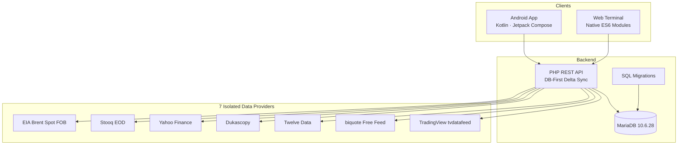

<!--
CHART Intelligence — project landing page
Detailed engineering and operational material: docs/04-development/PROJECT_GUIDE.md
-->

<p align="center">
  
</p>

<h1 align="center">CHART Intelligence</h1>

<p align="center">
  <strong>A modular financial chart analysis platform for web and Android.</strong><br>
  Multi-timeframe market data · Technical analysis foundation · Forecast evaluation roadmap
</p>

<p align="center">
  <a href="https://chart.manico.es"></a>
  <a href="https://github.com/manidigit/CHART/actions/workflows/build-apk.yml"></a>
  <a href="https://github.com/manidigit/CHART"></a>
  <a href="docs/01-product/CHART_INTELLIGENCE_MASTER_SPEC.md"></a>
</p>

<p align="center">
  <a href="#overview">Overview</a> ·
  <a href="#product">Product</a> ·
  <a href="#architecture">Architecture</a> ·
  <a href="#roadmap">Roadmap</a> ·
  <a href="#data-sources">Data sources</a> ·
  <a href="#documentation">Documentation</a>
</p>

---

## Overview

**CHART Intelligence** is an independent platform for viewing and analyzing financial market charts across multiple timeframes (`M15`, `M30`, `H1`, `H4`, `D1`, `W1`). The project combines a native Android application (Kotlin / Jetpack Compose) with a modular web terminal (`https://chart.manico.es`), unified through a PHP REST API and MariaDB central core.

The engineering direction prioritizes explicit market-series identity, UTC candle boundaries, pure independently testable algorithms, and a strict forecast validation roadmap.

> **Project status (Verified):** Phase 1 and the core subset of Phase 2 (12 indicators & SMC/VRVP overlays + 6 base drawing tools) are shipped in code. Remaining Phase 2 advanced drawing tools, secondary oscillators, live external fundamental/news feeds, and Phases 3–6 remain on the backlog — see [`OPEN_ISSUES.md`](docs/03-roadmap-and-issues/OPEN_ISSUES.md) and [`ROADMAP_BACKLOG.md`](docs/03-roadmap-and-issues/ROADMAP_BACKLOG.md).

## Product

### Shipped foundation (Web & Android)

- **Cross-Platform Parity (TradingView Pro Standard):** Responsive desktop/mobile web workspace (`host_subdomain`) and native Android Jetpack Compose app sharing the TradingView dark palette (`#131722`), circular vector asset badges, and `JetBrains Mono` LTR tabular digits.
- **Holistic 4-Section Workspace:** **Watchlist**, **Chart**, **Prediction** (pivot/ATR scenario ladder UI ready for Phase 4 engine), and **Settings** (5-tab organized configuration with `Reset All`).
- **Multi-Tab Chart & Core Phase 2 Studies:** Parallel chart tabs (`${SYMBOL}_${TF}`), timeframes (`15m`, `30m`, `1h`, `4h`, `1D`, `1W`), Heckbert nice-number price scaling (`[Auto] [Log]`), `UTC / Local` time axis, 11 quick date ranges (`1D..All`), 6 drawing tools (`HLINE`, `VLINE`, `TREND`, `FIB`, `LONG_POS`, `SHORT_POS` + Magnet), overlays (`SMA 20/50/200`, `EMA 20/50`, `Bollinger Bands`, `Supertrend`, `Session VWAP`, `MACD Classic Overlay`), lower synchronized panes (`Volume`, `RSI 14`, `MACD`, `ATR 14`), and market structure (`BOS/CHoCH`, `EQH/EQL`, `FVG`, `Estimated Session VRVP`).
- **Bilingual (`fa` / `en`) & BYOK:** Persian (RTL default) and English (LTR), salted SHA-256 owner login with `Remember Me` and 6-digit email OTP recovery, DB-First Delta Sync up to 5,000 candles, and isolated personal API keys (`BYOK` via `X-Provider-Api-Key`).

## Roadmap

The roadmap follows a strict **Build → Install → Practical Test → Owner Approval** gate between phases:

| Phase | Focus | Current State | Details |
|---:|---|---|---|
| 1 | Product foundation & multi-tab charts | **Shipped in code** | [ROADMAP_BACKLOG.md](docs/03-roadmap-and-issues/ROADMAP_BACKLOG.md) |
| 2 | Core indicators (`12`) shipped; remaining drawings (`Harmonic/Gann/Pitchfork/Cycle/AVWAP/FRVP`), secondary oscillators (`Parabolic SAR/Ichimoku/ADX/Stochastic/...`) & live external feeds (`RSS/SEC EDGAR`) | **Partial — Core Shipped / Remaining Backlog** | [ROADMAP_BACKLOG.md](docs/03-roadmap-and-issues/ROADMAP_BACKLOG.md) |
| 3 | Smart Gap detection, EIA/CSV imports & encrypted Backup/Restore | **Planned** | [ROADMAP_BACKLOG.md](docs/03-roadmap-and-issues/ROADMAP_BACKLOG.md) |
| 4 | Prediction Engine v1 (`Kronos` + `SMC`, `forecast-contract/v1`, SHA-256 chain) | **Planned** | [CHART_INTELLIGENCE_MASTER_SPEC.md](docs/01-product/CHART_INTELLIGENCE_MASTER_SPEC.md) |
| 5 | Live Feedback Loop, `Walk-Forward` & `Champion/Challenger` governance | **Planned** | [CHART_INTELLIGENCE_MASTER_SPEC.md](docs/01-product/CHART_INTELLIGENCE_MASTER_SPEC.md) |
| 6 | Offline Strategy Simulator & Multi-user admin | **Planned** | [TRADING_STRATEGY_SPEC.md](docs/01-product/TRADING_STRATEGY_SPEC.md) |

## Architecture

The repository separates the Android client, Web ES6 modules, PHP REST API, 7 data-provider adapters, and MariaDB migrations:



## Data sources

CHART keeps market-series identity explicit (`UNIQUE(chart_id, provider_id, timeframe, open_time_utc)`). Spot, CFD, EOD, and Futures series are strictly isolated and configured per symbol in **Settings**:

| Provider ID | Scope & Role | Default Symbols / Series |
|---|---|---|
| `tvdatafeed` | TradingView sockets & curated seeded archives (`M15..W1`) | `SPOTBRENT`, `USOIL`, `EURUSD` (primary) |
| `twelve_data` | REST API (server secret or `BYOK`) | `XAUUSD` (primary) |
| `biquote` | Keyless multi-asset intraday/daily feed | `XAGUSD`, `BTCUSD`, `ETHUSD` (primary) |
| `yahoo_finance` | US equities, global indices & futures | `SPX500USD`, `NDQ`, `NVDA..SAN` (primary); `BZ=F`, `GC=F` |
| `dukascopy` | Swiss interbank historical feed (`volume=0` weekend filter) | `SPOTBRENT`, `XAUUSD`, `XAGUSD`, `EURUSD` |
| `stooq` | Free multi-year EOD (`D1`/`W1`) CSV feed | Long-term daily/weekly validation & equities |
| `eia_brent_spot` | Official U.S. EIA daily benchmark (`RBRTEd`, 1987–present) | `SPOTBRENT` historical `D1` FOB benchmark |

## Repository layout

All markdown documentation (except this `README.md`) is organized under `docs/`:

```text
.
├── app/                                      # Native Android app (Kotlin, Compose, Coordinators, Room-free REST + local cache)
├── host_subdomain/
│   ├── api/v1/                               # PHP REST API (auth, candles_sync, workspace_sync, 7 adapters)
│   ├── scripts/                              # Python/PHP tvdatafeed extraction & cron scripts
│   ├── assets/                               # Web Native ES6 modules, algorithms, views & CSS design tokens
│   ├── data/tvdatafeed/                      # Seeded SPOTBRENT candles
│   ├── i18n/                                 # Web dictionaries (fa.json, en.json)
│   └── migrations/                           # Idempotent MariaDB migrations
├── docs/
│   ├── README.md                             # Documentation Hub & Role-Based Reading Guide
│   ├── assets/chart-hero.svg                 # Repository hero banner
│   ├── 01-product/
│   │   ├── CHART_INTELLIGENCE_MASTER_SPEC.md # Primary source of truth (product, contracts, formulas, phases)
│   │   ├── GROK_OPENMARKET_RESEARCH_NOTES.md # Provider & ML architecture research notes
│   │   └── TRADING_STRATEGY_SPEC.md          # Phase 6 offline strategy simulation spec
│   ├── 02-architecture/
│   │   ├── ARCHITECTURE.md                   # Central Core, DB-First Delta Sync, 7 providers & 22 symbols
│   │   ├── DESIGN_WORKSPACE_SPEC.md          # TradingView Pro workspace layout, layers & tokens
│   │   ├── INFRASTRUCTURE_INVENTORY.md       # Verified cPanel / MariaDB host inventory & limits
│   │   └── SECURITY.md                       # Security policy, zero-secrets & BYOK isolation
│   ├── 03-roadmap-and-issues/
│   │   ├── OPEN_ISSUES.md                    # Verified open bugs, partial implementations & open questions
│   │   └── ROADMAP_BACKLOG.md                # Truthful Shipped Core vs Phase 2–6 backlog
│   └── 04-development/
│       ├── PROJECT_GUIDE.md                  # Code-vs-Spec audit table, secrets registry & CI/CD guide
│       ├── AGENTS.md                         # AI & developer invariants, UI directives & user flow
│       ├── CONTRIBUTING.md                   # Build, test & PR workflow
│       └── CHANGELOG.md                      # Chronological release history
├── .github/workflows/
│   └── build-apk.yml                         # Android APK build + Web/DB cPanel deployment workflow
└── README.md                                 # Project landing page
```

## Documentation

Start at [`docs/README.md`](docs/README.md) for the full reading order by role, or jump directly to:
- **Truthful Current Status & Active Work:** [`OPEN_ISSUES.md`](docs/03-roadmap-and-issues/OPEN_ISSUES.md) · [`ROADMAP_BACKLOG.md`](docs/03-roadmap-and-issues/ROADMAP_BACKLOG.md)
- **Specs & Architecture:** [`CHART_INTELLIGENCE_MASTER_SPEC.md`](docs/01-product/CHART_INTELLIGENCE_MASTER_SPEC.md) · [`ARCHITECTURE.md`](docs/02-architecture/ARCHITECTURE.md) · [`DESIGN_WORKSPACE_SPEC.md`](docs/02-architecture/DESIGN_WORKSPACE_SPEC.md)
- **Developer & Ops:** [`PROJECT_GUIDE.md`](docs/04-development/PROJECT_GUIDE.md) · [`AGENTS.md`](docs/04-development/AGENTS.md) · [`INFRASTRUCTURE_INVENTORY.md`](docs/02-architecture/INFRASTRUCTURE_INVENTORY.md) · [`SECURITY.md`](docs/02-architecture/SECURITY.md)

## Project principles

- **Evidence over assumptions:** Verify the actual repository code before marking any spec item complete.
- **Modularity:** Keep screens, components, providers, and pure math algorithms cleanly separated.
- **Data integrity:** Preserve instrument identity (`chart_id`), UTC timestamps, and `DECIMAL(18,8)` price precision.
- **Security by design:** Never commit secrets or send personal API keys inside shared workspace sync payloads.

---

<p align="center">
  <strong>CHART Intelligence</strong><br>
  <sub>Analyze clearly. Validate continuously. Improve with evidence.</sub>
</p>
